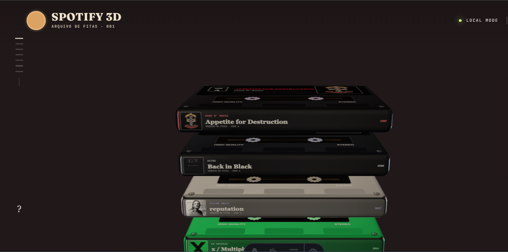
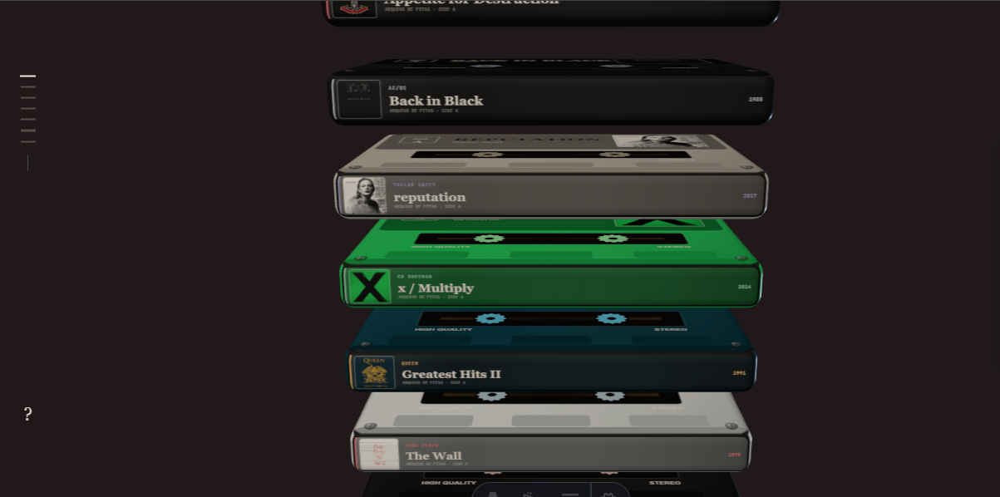
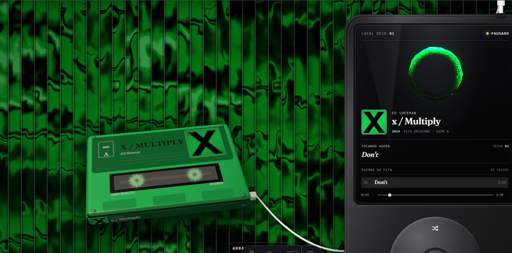

# Spotify 3D — arquivo de fitas

Uma estante 3D de fitas cassete para organizar e ouvir uma coleção musical **local**. Cada álbum vira uma fita renderizada em WebGL com a capa, as cores e a tipografia do disco; ao escolher uma fita, ela é "plugada" num player estilo iPod com um fundo animado gerado a partir da paleta da capa.

> Não há integração com a API do Spotify — o nome é só a inspiração. Tudo roda no navegador, a partir de arquivos locais.



## Screenshots

| Estante | Player |
| --- | --- |
|  |  |

## Recursos

- **Estante 3D** com [Three.js](https://threejs.org/): fitas geradas proceduralmente (carcaça, carretéis, etiqueta e lombada) a partir de `albums.json`.
- **Paleta automática**: as cores do fundo e dos destaques são extraídas da capa do álbum ativo.
- **Fundo "fluted glass"** em shader, animado no ritmo do player.
- **Cabo físico** entre a fita e o player, simulado com integração de Verlet (dá pra puxar com o mouse).
- **Player** com lista de faixas, progresso, shuffle e repeat, usando o `<audio>` nativo do navegador.
- **Arraste para girar** a fita na visualização de detalhe.

## Stack

- [Astro](https://astro.build/) 7
- [Three.js](https://threejs.org/)
- JavaScript puro para as cenas e interações (sem framework de UI)

## Rodando localmente

Requer Node.js `>= 22.12`.

```sh
npm install
npm run dev
```

Build de produção:

```sh
npm run build
npm run preview
```

## Músicas

Os arquivos de áudio **não estão no repositório** (são obras protegidas por direitos autorais). As pastas em `public/audio/` existem vazias; coloque ali seus próprios arquivos seguindo os caminhos cadastrados em `src/data/albums.json`. Sem os áudios, a interface funciona normalmente, mas o player não toca.

## Como adicionar um álbum

1. Coloque a capa quadrada em `public/covers/`.
2. Coloque os arquivos de áudio em `public/audio/<id-do-album>/`.
3. Adicione o álbum em `src/data/albums.json`:

```json
{
  "id": "meu-album",
  "title": "Meu Álbum",
  "shortTitle": "Meu Álbum",
  "artist": "Minha Banda",
  "year": 2026,
  "color": "#b46e49",
  "accent": "#f4b45d",
  "ink": "#18181c",
  "cover": "/covers/meu-album.jpg",
  "tracks": [
    {
      "title": "Minha Música",
      "src": "/audio/meu-album/01-minha-musica.mp3",
      "duration": "3:42"
    }
  ]
}
```

`color` é a cor da carcaça da fita, `accent` a dos detalhes e `ink` a do texto da etiqueta. Os caminhos de áudio podem apontar para MP3, WAV ou OGG.

## Estrutura

```text
src/
├── data/albums.json          # catálogo de álbuns e faixas
├── pages/
│   ├── index.astro           # estante + player (versão 001)
│   └── 2.astro               # variação do layout (versão 002)
└── scripts/
    ├── tape-shelf.js         # cena 3D da estante e das fitas
    ├── solaris-player.js     # visual do player
    ├── fluted-background.js  # shader do fundo
    ├── tape-cable.js         # simulação do cabo
    └── color-palette.js      # extração de paleta da capa
```

## Aviso

Projeto pessoal e sem fins comerciais. Capas de álbuns e nomes de artistas pertencem aos seus respectivos detentores de direitos. "Spotify" é marca registrada da Spotify AB; este projeto não tem nenhuma afiliação com a empresa.
